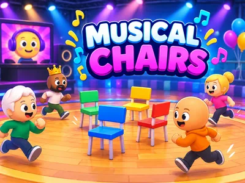
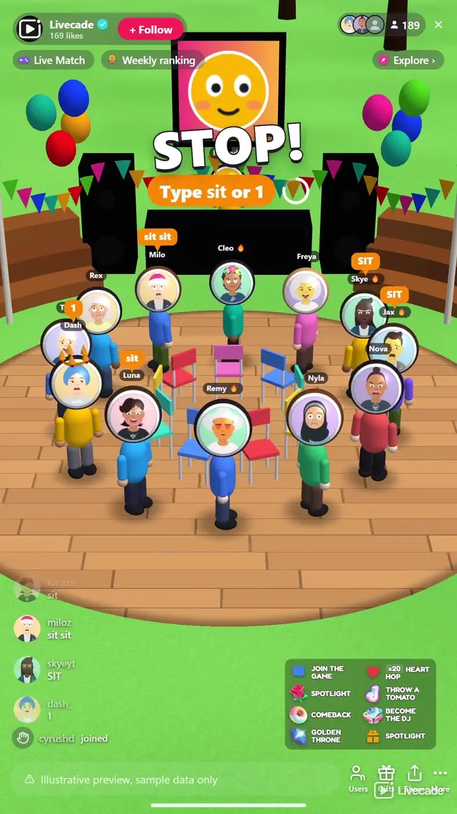

# Musical Chairs - Interactive TikTok Live Game

> Your viewers race for the last chair when the music stops.

Your viewers walk around a ring of chairs as bobbleheads with their own faces, and when the music stops they type sit to grab a seat. Gifts throw tomatoes, light spotlights, buy golden thrones and hand a viewer the DJ booth.

**[Play Musical Chairs on Livecade](https://livecade.io/games/musical-chairs/?utm_source=github&utm_medium=readme&utm_campaign=musical-chairs)** - runs as a single browser source in OBS, Streamlabs, or TikTok LIVE Studio. Nothing for viewers to install.

## How viewers play

Viewers take part with the actions TikTok already gives them: **comments**, **gifts**, **likes**. Every action below is rebindable, so you decide which interaction drives which effect.

| Action | What it does |
| --- | --- |
| **Join the game** | Walks onto the ring with the viewer's face. Any comment by default |
| **Heart hop** | The viewer hops with a heart over their head. 20 likes by default |
| **Spotlight** | A spotlight on the sender that makes them bigger with every Rose, up to five times, with their name in large letters. A Rose by default |
| **Throw a tomato** | A tomato at a player that splats on their face, up to three for a streak. A TikTok by default |
| **Comeback** | An eliminated viewer walks back onto the ring at the next walk, once a game. A viewer still in gets a spare life. A Doughnut by default |
| **Become the DJ** | The sender's face on the booth screen for a round, and they stop the music by typing stop. A Hand Heart by default |
| **Golden throne** | The holder is safe at the next stop without racing and wears a crown. A second throne covers the stop after. A Galaxy by default |

## How it works

### Comment to join

Any comment puts the viewer on the ring as a bobblehead with their profile picture. Up to 300 play at once, and anyone who joins when the game is full plays the next one.

### Type sit when the music stops

The first to type it reach the nearest free chair. Sits count by when they were typed, so a slow connection costs nothing, and typing sit while the music plays trips you.

### Fewer chairs every round

Whoever is left standing goes to the stands, the ring shrinks and the walk gets faster, until two players race for one chair in the final.

### Your music, your stop

Play your own songs from the Music tab. The game stops them at random or when you press Stop music, and a Fake stop catches anyone who sits too early.

## About the game

Musical Chairs puts a party on your stream: a ring of chairs on a wooden deck, a DJ booth with your face on its screen, and your viewers walking around the chairs as bobbleheads with their TikTok profile pictures as faces. Any comment joins the game. When the music stops, the big STOP card goes up and everyone types sit. The first to type it run for the nearest free chair, and whoever is left standing goes to the stands to watch. Each round has fewer chairs, until two players fight over the last one.

### Fair on a real live

Sits count in the order viewers typed them, by TikTok's own time stamp, not by when the comment reached the stream, so a slow connection does not cost anyone a chair. Typing sit while the music still plays trips you, and you sit late. The music is yours: play your own songs from the Music tab and the game cuts them at every stop and picks them up again where they left off.

### Gifts that change the round

Out of the box a Rose puts the sender in a spotlight that makes them bigger with every Rose, a TikTok throws tomatoes at the players, a Doughnut brings an eliminated viewer back for the next walk, a Hand Heart makes the sender the DJ who stops the music by typing stop, and a Galaxy buys a golden throne that keeps its holder safe at the next stop. Every gift shows on its sender, in the ring or in the stands.

### You run the music

Let the game stop the music at random, or stop it yourself from the dock, where a Fake stop teases a STOP that is not one, so anyone who types sit too early trips. A Wins tonight board keeps the night's winners on screen, and the game plays from two viewers to three hundred.

## What it looks like on stream

[Watch Musical Chairs gameplay](https://cdn.livecade.io/games/musical-chairs.mp4)

## What you can configure

- **Language** - Thirteen languages for everything on screen and for the sit word viewers type, which works in English in every language too
- **Who stops the music** - Automatic, after 8 to 20 seconds by default, or manual from the dock, with a stop by itself after 40 seconds if you forget
- **Max players** - 20 to 300, 150 by default. Viewers who join when the game is full play the next one
- **Viewer DJ** - How long a viewer DJ can hold the music before it stops by itself: 15 to 120 seconds, 25 by default. They stop it any time by typing stop
- **Time to sit** - 3 to 10 seconds, 5 by default. Raise it if your viewers say they typed in time
- **Robot players** - Robots fill the game until six viewers play, so a quiet stream still has a game. They never beat a real viewer
- **Chat bubbles** - Viewers' messages over their heads, how many at once and for how long
- **Appearance** - The colours of the sit word, the highlights and the panels on screen

## Languages

English, Spanish, Portuguese, French, German, Italian, Indonesian, Arabic, Turkish, Russian, Hindi, Romanian, Filipino

## FAQ

<strong>How do viewers join Musical Chairs?</strong>

Out of the box any comment joins. The viewer walks onto the ring as a bobblehead with their TikTok profile picture. Every trigger can be rebound, so likes, follows or a gift can be the way in instead.

<strong>How do viewers sit down?</strong>

When the music stops and the STOP card goes up, they type sit, or the word in the stream's language. The first to type it get the nearest free chairs. Typing sit while the music still plays trips them, and they sit late.

<strong>Is it fair with stream delay?</strong>

Yes. Sits count in the order viewers typed them, using TikTok's own time stamp, so a comment that reaches the stream a little late still counts in the order it was typed. You can also give viewers more time to sit in the settings.

<strong>Can I play my own music?</strong>

Yes. Play your own songs from the Music tab. The game cuts the music at every stop and carries on from the same spot at the next walk. Pausing the music yourself during a walk counts as a stop.

<strong>What do gifts do?</strong>

By default a Rose lights a spotlight on the sender, a TikTok throws tomatoes, a Doughnut brings an eliminated viewer back, a Hand Heart makes the sender the DJ and a Galaxy buys a golden throne that keeps them safe at the next stop. A gift with no trigger of its own lights a spotlight that grows with its value.

<strong>How many viewers can play?</strong>

From two to three hundred on the ring at once, with up to 120 eliminated viewers shown in the stands. Viewers who join when the game is full play the next one.

<strong>How do I add Musical Chairs to my TikTok Live?</strong>

Add one browser source URL to OBS or TikTok LIVE Studio and go live. The game is a 9:16 vertical overlay, and there is no plugin or app to install.

## Setup

1. [Create a Livecade account](https://app.livecade.io/register?utm_source=github&utm_medium=cta&utm_campaign=musical-chairs)
2. Copy your overlay browser source URL
3. Paste it into OBS, Streamlabs, or TikTok LIVE Studio
4. Pick Musical Chairs, set your triggers, and go live

Runs in the browser, so it works on Windows and macOS with nothing to download. [See all TikTok Live games](https://livecade.io/tiktok-live-games/?utm_source=github&utm_medium=readme&utm_campaign=musical-chairs).

---

_This repository documents Musical Chairs, a hosted interactive game by [Livecade](https://livecade.io/?utm_source=github&utm_medium=footer&utm_campaign=musical-chairs). The game runs on Livecade's platform, so there is no source to install here._
